# TwinCAT 3 Event Logger

**A decoupled, scan-cycle-safe event/alarm logging framework for industrial PLCs — built in IEC 61131-3 (Structured Text) on Beckhoff TwinCAT 3.**

[]()
[-orange)]()
[]()
[-lightgrey)]()
[]()

## At a Glance

- 🏗️ **Interface-driven architecture** — the logger doesn't know or care *how* events get stored. Today it's CSV; swap in a database, OPC UA, or MQTT backend without touching the logging logic.
- ⏱️ **Non-blocking, scan-cycle-safe file I/O** — a `CASE`-based state machine drives `FB_FileOpen` / `FB_FilePuts` across scan cycles instead of blocking the PLC task, the way production alarm systems have to.
- 🔁 **Ring-buffered event queue** — events arriving faster than the disk write can keep up are queued in a purpose-built `FB_EventRingBuffer` instead of overwriting each other in a single-slot mailbox.
- 🖥️ **Live TwinCAT HMI** — a built-in visualization showing the 10 most recent events, with buttons to fire test alarms and clear the log, bound directly to PLC variables (no external HMI server).
- 🧱 **Object-oriented Structured Text** — function blocks, `PUBLIC` / `PRIVATE` methods, a constructor-style `FB_init` for dependency injection, and a formal `INTERFACE`.
- 🛡️ **Overflow-protected buffer** — a fixed 100-slot event array with an explicit `IsBufferFull` guard, so a runaway event source can't overrun memory.
- 📄 **Structured event model** — type (Alarm/Message), severity, identity, timestamp and free text, the same shape used by real SCADA/HMI alarm & event logs.

## Table of Contents

- [Overview](#overview)
- [Architecture](#architecture)
- [Project Structure](#project-structure)
- [Core Components](#core-components)
  - [1. Data Model](#1-data-model)
  - [2. eventLogger Function Block](#2-eventlogger-function-block)
  - [3. Persistence Layer](#3-persistence-layer)
  - [4. MAIN Program](#4-main-program)
  - [5. Timestamp Utility](#5-timestamp-utility)
  - [6. HMI Layer](#6-hmi-layer)
- [How It Works](#how-it-works)
- [Tech Stack](#tech-stack)
- [Getting Started](#getting-started)
- [Changelog](#changelog)
- [Roadmap](#roadmap)
- [Author](#author)

## Overview

This project is a lightweight **event/alarm logging system** for Beckhoff TwinCAT 3, written in IEC 61131-3 Structured Text. It captures structured events (alarms and messages, each with a severity, an identity code, free text and a timestamp), persists them to disk as CSV, and now exposes them to a live HMI screen.

The goal wasn't just "log some data" — it was to apply patterns that matter in real industrial software:

- Keep the *logging logic* completely independent from the *storage mechanism* (interface + dependency injection), so the persistence backend can be swapped without touching the logger.
- Never block the PLC's cyclic task while doing file I/O — file operations are driven through an explicit state machine instead of a single blocking call.
- Never silently drop an event because the writer was still busy — a ring buffer decouples the rate events arrive from the rate they can be written.
- Protect the runtime buffer from overflow instead of assuming every event will be consumed in time.
- Give operators a way to actually *see* events, not just a file on disk — a minimal read-only interface drives a live table on an HMI screen.

## Architecture

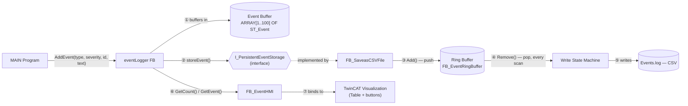

`eventLogger` never references `FB_SaveasCSVFile` directly — it only knows about the `I_PersistentEventStorage` interface, injected through its constructor (`FB_init`). Swap the CSV implementation for a SQL, OPC UA, or MQTT one, and the logger itself doesn't change.

Three separate concerns sit around `eventLogger`'s buffer: `FB_EventRingBuffer` is an internal write-queue inside `FB_SaveasCSVFile` that absorbs bursts before they hit disk; `FB_EventHMI` is a read-only consumer that pulls from `eventLogger` on demand to drive the visualization; neither writes back into `eventLogger`'s own buffer.

## Project Structure

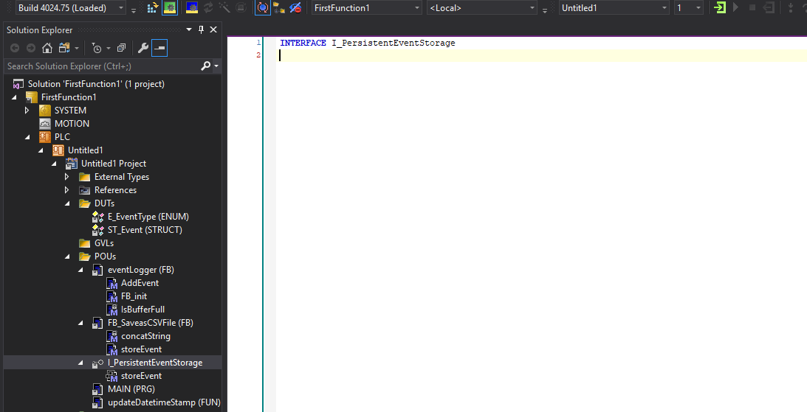

```
FirstFunction1/
└── PLC/Untitled1/Untitled1 Project/
    ├── DUTs/
    │   ├── E_EventType (ENUM)
    │   ├── ST_Event (STRUCT)
    │   └── ST_EventRow (STRUCT)
    ├── POUs/
    │   ├── eventLogger (FB)
    │   │   ├── AddEvent
    │   │   ├── ClearBuffer
    │   │   ├── FB_init
    │   │   ├── GetCount
    │   │   ├── GetEvent
    │   │   └── IsBufferFull
    │   ├── FB_SaveasCSVFile (FB)
    │   │   ├── concatString
    │   │   └── storeEvent
    │   ├── FB_EventRingBuffer (FB)
    │   │   ├── Add
    │   │   └── Remove
    │   ├── FB_EventHMI (FB)
    │   ├── I_PersistentEventStorage (INTERFACE)
    │   │   └── storeEvent
    │   ├── MAIN (PRG)
    │   └── updateDatetimeStamp (FUN)
    └── VISU/
        └── EventScreen (Target/Web Visualization)
```

## Core Components

### 1. Data Model

`ST_Event` is the shape of every logged event; `E_EventType` distinguishes an `Alarm` from a `Message`.

<p float="left">
  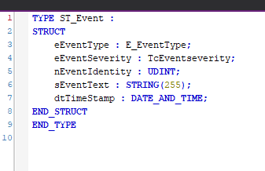
  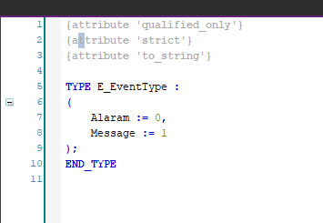
</p>

```st
TYPE ST_Event :
STRUCT
    eEventType     : E_EventType;
    eEventSeverity : TcEventSeverity;
    nEventIdentity : UDINT;
    sEventText     : STRING(255);
    dtTimeStamp    : DATE_AND_TIME;
END_STRUCT
END_TYPE
```

### 2. eventLogger Function Block

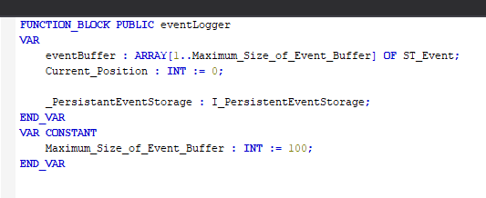

Holds a fixed-size buffer (`ARRAY[1..100] OF ST_Event`) and a reference to whatever persistence strategy was injected at construction.

**Constructor / dependency injection — `FB_init`**

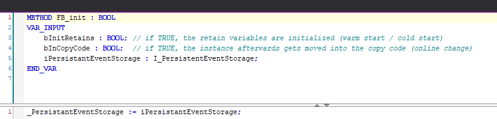

`FB_init` accepts an `I_PersistentEventStorage` instance and stores it. This is the dependency-injection point: `MAIN` decides *what* gets used to persist events, `eventLogger` just uses it.

**`AddEvent`** — public entry point for logging a new event

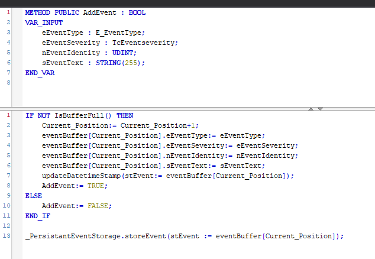

Checks the buffer isn't full, appends the event, stamps it with the current time, and forwards it to the injected storage strategy.

**`IsBufferFull`** — private overflow guard

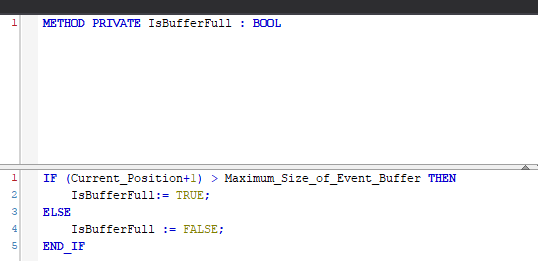

**Read interface — `GetCount`, `GetEvent`, `ClearBuffer`**

Added to let external consumers (the HMI, in this case) read the buffer without any direct field access:

```st
METHOD PUBLIC GetCount : INT
GetCount := Current_Position;
```

```st
METHOD PUBLIC GetEvent : BOOL
VAR_INPUT
    nIndex : INT;          // 1..Current_Position
END_VAR
VAR_OUTPUT
    stEvent : ST_Event;
END_VAR

IF (nIndex >= 1) AND (nIndex <= Current_Position) THEN
    stEvent  := eventBuffer[nIndex];
    GetEvent := TRUE;
ELSE
    GetEvent := FALSE;
END_IF
```

```st
METHOD PUBLIC ClearBuffer
Current_Position := 0;     // clears the in-memory list only; Events.log is untouched
```

### 3. Persistence Layer

`I_PersistentEventStorage` is a one-method interface (`storeEvent`) — the contract the logger depends on. `FB_SaveasCSVFile` is the concrete implementation used today.

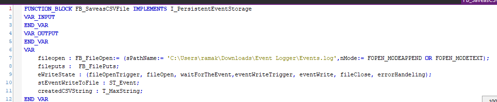

**`FB_EventRingBuffer`** — queues events between arrival and the write state machine

A fixed-capacity circular queue: `Add` pushes on arrival, `Remove` pops one entry per scan whenever the writer is idle. Wrap-around is handled with `MOD`, so the queue never needs to shift elements.

```st
FUNCTION_BLOCK PUBLIC FB_EventRingBuffer
VAR CONSTANT
    Capacity : INT := 50;
END_VAR
VAR
    aBuffer : ARRAY[0..Capacity-1] OF ST_Event;
    nHead   : INT := 0;   // next write index
    nTail   : INT := 0;   // next read index
    nCount  : INT := 0;   // elements currently queued
END_VAR
```

```st
METHOD PUBLIC Add : BOOL
VAR_INPUT
    stEvent : ST_Event;
END_VAR

IF nCount >= Capacity THEN
    Add := FALSE;   // full — caller decides how to handle a dropped event
ELSE
    aBuffer[nHead] := stEvent;
    nHead  := (nHead + 1) MOD Capacity;
    nCount := nCount + 1;
    Add    := TRUE;
END_IF
```

```st
METHOD PUBLIC Remove : BOOL
VAR_OUTPUT
    stEvent : ST_Event;
END_VAR

IF nCount = 0 THEN
    Remove := FALSE;
ELSE
    stEvent := aBuffer[nTail];
    nTail   := (nTail + 1) MOD Capacity;
    nCount  := nCount - 1;
    Remove  := TRUE;
END_IF
```

**Non-blocking file-write state machine**

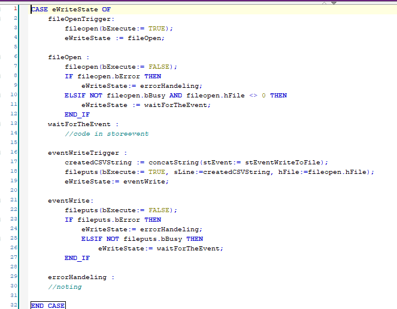
*Screenshot shows the pre-ring-buffer version — `waitForTheEvent` now pulls from the queue below.*

```st
CASE eWriteState OF
    fileOpenTrigger   : (* trigger FB_FileOpen *)
    fileOpen          : (* wait for open to finish, handle errors *)

    waitForTheEvent    :
        IF _RingBuffer.Remove(stEvent => stEventWriteToFile) THEN
            eWriteState := eventWriteTrigger;
        END_IF

    eventWriteTrigger : (* serialize event to CSV, trigger FB_FilePuts *)
    eventWrite        : (* wait for write to finish, handle errors *)
    errorHandeling    : (* recovery hook *)
END_CASE
```

Because it's state-driven instead of blocking, this runs safely inside a normal PLC scan cycle — no loops waiting on I/O to complete. `waitForTheEvent` now drains one queued event per scan whenever the writer is free, regardless of whether a *new* event happens to arrive that cycle.

**`concatString`** — serializes an `ST_Event` into a CSV line

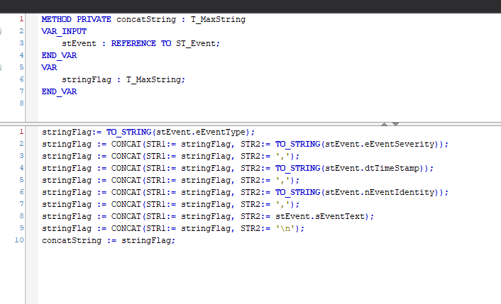

**`storeEvent`** — the interface implementation; now a pure enqueue

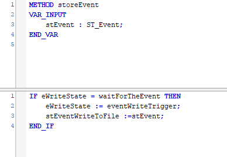
*Screenshot shows the pre-ring-buffer version, which wrote directly into a single-slot mailbox. Current implementation:*

```st
METHOD storeEvent
VAR_INPUT
    stEvent : ST_Event;
END_VAR

_RingBuffer.Add(stEvent := stEvent);
```

`storeEvent` no longer touches `eWriteState` at all — it only pushes onto the ring buffer. Draining happens independently in `waitForTheEvent` above, so a backlog keeps draining even if events stop arriving mid-write.

### 4. MAIN Program

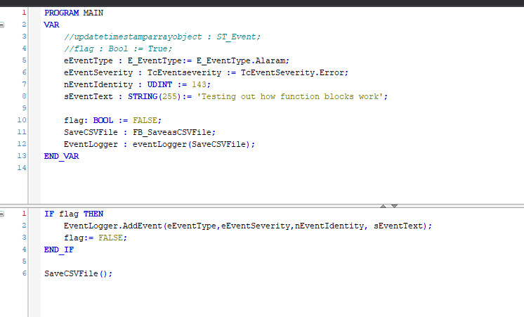
*Screenshot shows the pre-HMI version. Current wiring adds the HMI instance and a clear-button pulse — see below.*

```st
PROGRAM MAIN
VAR
    SaveCSVFile  : FB_SaveasCSVFile;
    EventLogger  : eventLogger(SaveCSVFile);
    HMI          : FB_EventHMI;

    bTestAlarm   : BOOL;     // HMI button
    bClearLog    : BOOL;     // HMI button
    bClearPulse  : BOOL;
    nTestCounter : UDINT;
END_VAR
```

```st
IF bTestAlarm THEN
    bTestAlarm   := FALSE;
    nTestCounter := nTestCounter + 1;
    EventLogger.AddEvent(E_EventType.Alarm, TcEventSeverity.Error, nTestCounter, 'Test alarm from HMI');
END_IF

bClearPulse := bClearLog;
IF bClearLog THEN
    bClearLog := FALSE;
    EventLogger.ClearBuffer();
END_IF

SaveCSVFile();
HMI(Logger := EventLogger, bClearRequest := bClearPulse);
```

### 5. Timestamp Utility

`updateDatetimeStamp` reads the system clock via `GETSYSTEMTIME` and converts it into a `DATE_AND_TIME` value on the event.

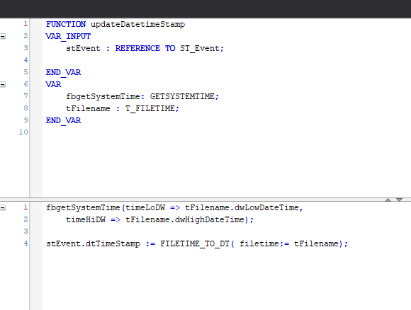

### 6. HMI Layer

*No screenshot yet — added after the visualization screen is captured.*

A display-ready row type keeps all formatting out of the visualization itself:

```st
TYPE ST_EventRow :
STRUCT
    sTime     : STRING(30);
    sType     : STRING(20);
    sSeverity : STRING(20);
    nID       : UDINT;
    sText     : STRING(80);
END_STRUCT
END_TYPE
```

`FB_EventHMI` polls `eventLogger` through its read interface, shows the 10 newest events newest-first, refreshes only when the count changes, and clears on an explicit one-scan pulse rather than relying on the count change alone:

```st
FUNCTION_BLOCK FB_EventHMI
VAR_IN_OUT
    Logger : eventLogger;
END_VAR
VAR_INPUT
    bClearRequest : BOOL;   // pulse TRUE for one scan when the HMI clear button fires
END_VAR
VAR_OUTPUT
    aRows  : ARRAY[1..10] OF ST_EventRow;
    nTotal : INT;
END_VAR
VAR
    nLastTotal : INT := -1;
    i          : INT;
    stEvent    : ST_Event;
    stEmptyRow : ST_EventRow;
END_VAR
```

```st
IF bClearRequest THEN
    FOR i := 1 TO 10 DO
        aRows[i] := stEmptyRow;
    END_FOR
    nTotal     := 0;
    nLastTotal := 0;   // stays in sync so the next real event still triggers a refresh

ELSIF Logger.GetCount() <> nLastTotal THEN
    nLastTotal := Logger.GetCount();
    nTotal     := nLastTotal;

    FOR i := 1 TO 10 DO
        IF Logger.GetEvent(nIndex := nTotal - i + 1, stEvent => stEvent) THEN
            aRows[i].sTime     := TO_STRING(stEvent.dtTimeStamp);
            aRows[i].sType     := TO_STRING(stEvent.eEventType);
            aRows[i].sSeverity := TO_STRING(stEvent.eEventSeverity);
            aRows[i].nID       := stEvent.nEventIdentity;
            aRows[i].sText     := LEFT(stEvent.sEventText, 80);
        ELSE
            aRows[i] := stEmptyRow;
        END_IF
    END_FOR
END_IF
```

**The visualization screen** (TwinCAT PLC HMI / TF1800) is a Table bound to `MAIN.HMI.aRows` (columns: Time, Type, Severity, ID, Message), a text field bound to `MAIN.HMI.nTotal`, and two buttons ("Test alarm", "Clear log") that tap `MAIN.bTestAlarm` and `MAIN.bClearLog`. Nothing in the screen itself holds logic — every value is a direct variable binding.

## How It Works

1. Somewhere in the PLC program, code calls `EventLogger.AddEvent(eventType, severity, identity, text)`.
2. `eventLogger` checks its own buffer isn't full, appends the event, and stamps it with the current time.
3. `eventLogger` forwards the event to whatever implements `I_PersistentEventStorage` — today, `FB_SaveasCSVFile.storeEvent`.
4. `storeEvent` pushes the event onto `FB_EventRingBuffer` and returns immediately — it never waits on the writer.
5. Every scan, if the write state machine is idle, `waitForTheEvent` pops one event off the ring buffer and hands it to the writer.
6. The writer serializes the event to CSV and writes it to `Events.log`, then returns to idle to pop the next queued event.
7. Independently, `FB_EventHMI` polls `eventLogger.GetCount()` each scan; when it changes, it pulls the 10 newest events via `GetEvent()` and formats them into `aRows` for the screen.
8. Pressing "Clear log" on the HMI sets `bClearLog`, which calls `EventLogger.ClearBuffer()` and, in the same scan, pulses `FB_EventHMI.bClearRequest` so the table blanks immediately rather than waiting on the next count change.

## Tech Stack

| Category | Details |
|---|---|
| PLC Runtime | Beckhoff TwinCAT 3 |
| Language | IEC 61131-3 — Structured Text (ST) |
| Paradigm | Object-oriented ST (function blocks, interfaces, methods) |
| Persistence | CSV via `FB_FileOpen` / `FB_FilePuts` |
| Visualization | TwinCAT PLC HMI (TF1800) — direct variable binding, no external HMI server |
| Patterns | Dependency Injection, Strategy, State Machine, Ring Buffer (Producer/Consumer) |

## Getting Started

1. Open the solution in TwinCAT 3 (XAE).
2. Build and activate the configuration.
3. Log in and go online.
4. Open the `EventScreen` visualization, or drive it directly from the variable list: set `MAIN.bTestAlarm := TRUE` to fire a sample event, `MAIN.bClearLog := TRUE` to clear the table.
5. Check `Events.log` at the configured path — it keeps growing even after a Clear, since Clear only empties the in-memory buffer and HMI view.

## Changelog

- **v1.2** — Added a read interface (`GetCount`, `GetEvent`, `ClearBuffer`) to `eventLogger`, a `FB_EventHMI` block, and a TwinCAT visualization screen with a live event table, test-alarm button, and clear button with immediate (same-scan) table clearing.
- **v1.1** — Added `FB_EventRingBuffer` between `storeEvent` and the CSV write state machine, replacing the single-slot mailbox so back-to-back events no longer overwrite each other before they're written.
- **v1.0** — Initial event logger: `ST_Event` / `E_EventType` model, `eventLogger` FB with a fixed 100-slot buffer, interface-based CSV persistence via `FB_SaveasCSVFile`.

## Roadmap

Honest next steps if this were headed to production:

- [ ] Apply the same ring-buffer pattern to `eventLogger`'s own 100-slot buffer (still a fixed lockout array, not circular)
- [ ] Only forward to `storeEvent` on a *successful* `AddEvent` — the forwarding call still sits outside the success/fail branch
- [ ] Surface `FB_EventRingBuffer.Add`'s return value as a dropped-event counter when the queue is full
- [ ] Move the hardcoded log file path into a configurable `GVL` / parameter
- [ ] Add a second `I_PersistentEventStorage` implementation (e.g. OPC UA or a database) to prove out the strategy pattern
- [ ] Add TcUnit tests around ring buffer wraparound and the CSV write state machine
- [ ] Collapse empty HMI rows via per-row visibility dynamics instead of showing blank rows below `nTotal`
- [ ] Color-code HMI rows by `eEventSeverity` for faster operator scanning
- [ ] Evaluate a TF2000 web-based HMI as a browser-accessible upgrade path

## Author

**Ramakrishna Tikka**
M.Sc. Mechatronics & Robotics — Hochschule Schmalkalden, Germany
Focus: Battery analytics, embedded systems, industrial automation

[LinkedIn](#) · [Email](#) · [GitHub](#)
